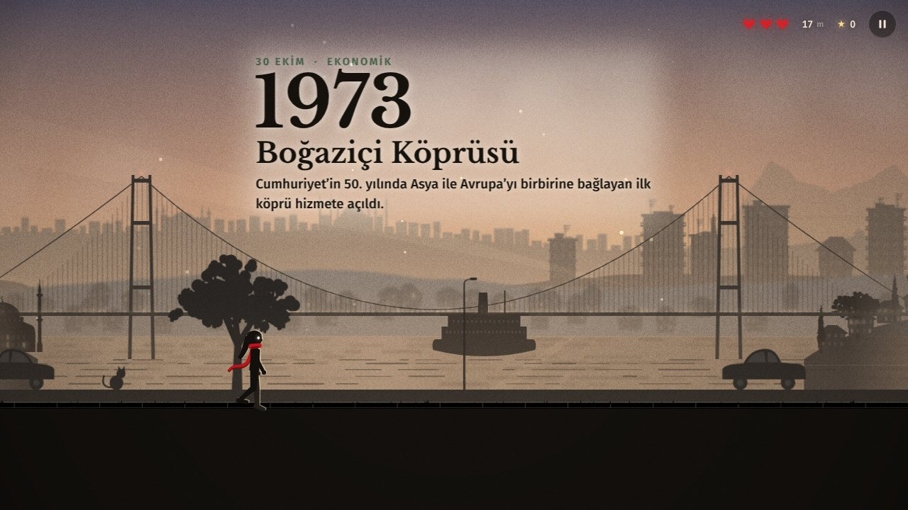
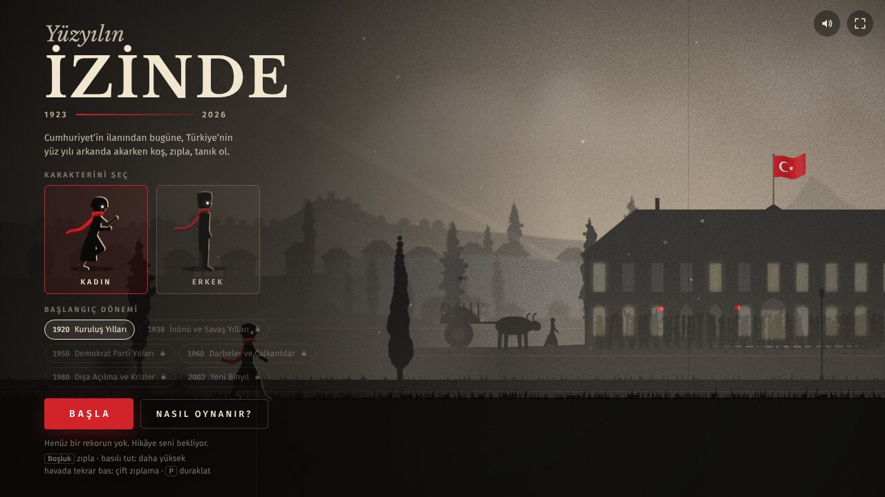
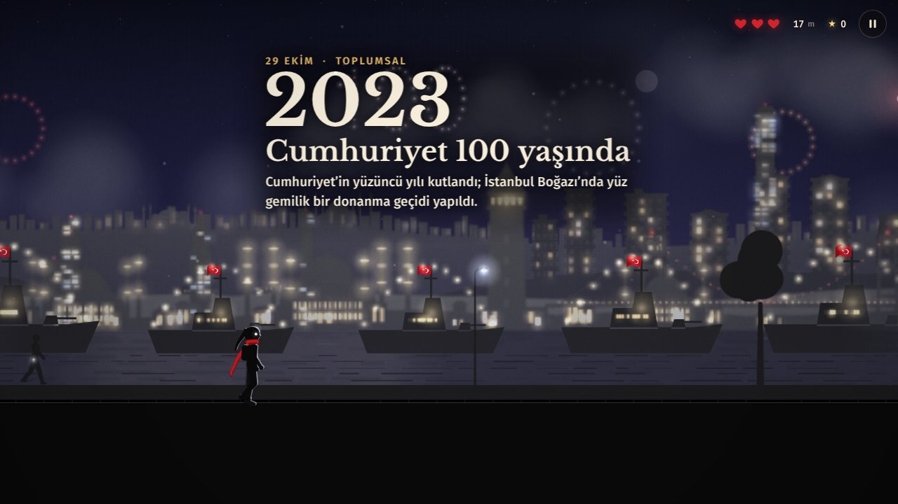

# Yüzyılın İzinde

**Türkiye’nin yüz yılı arkanda akarken koş, zıpla, tanık ol.**

Soldan sağa akan, 2.5B görünümlü bir sonsuz koşu oyunu. Siluet karakterin engellerin üzerinden atlarken arka planda 1920’den 2026’ya Türkiye’nin önemli siyasi, toplumsal, ekonomik ve doğal olayları sırayla canlanır: Meclis’in açılışı, Sakarya ve Büyük Taarruz, Cumhuriyet’in ilanı, Harf Devrimi, Atatürk’ün ölümü, çok partili hayat, anayasalar, darbeler, depremler, köprüler, krizler, Cumhuriyet’in 100. yılı ve bugün. Tarihler ve olaylar ayrı bir yazı kutusunda değil, sahnenin içinde, arka planın bir parçası olarak belirir.



| | |
|---|---|
|  |  |

## Öne çıkanlar

- **105 olay, 7 dönem, yaklaşık 2 saat 15 dakikalık yolculuk.** Her yıl ortalama 75 saniye sürer; 1920’den bugüne kesintisiz koşmak 2 saati aşar. Olaylar için 67 ayrı, tek tek tasarlanmış arka plan sahnesi var (anayasa kürsüsü, oylama panosu, Körfez Savaşı, devlet töreni, Karadeniz’de sondaj gemisi…). Dönem değiştikçe gökyüzü, renkler, film dokusu, şehir siluetleri ve engeller de değişir (sepya film → siyah-beyaz → renkli → VHS → bugün); olayın ruhuna göre hava da değişir: kar, yağmur, sis, deprem tozu, yangın dumanı, bayram geceleri. Depremler sarsıntı efekti olmadan, bir anma olarak gösterilir.
- **Sahneye yedirilmiş tarih.** Olayın yılı dev rakamlarla, başlığı ve açıklaması da büyük tipografiyle sahnenin katmanları arasına yazılır: en önde değil, en arkada da değil; uzak tepelerle yakın ağaçların arasında, onlarla birlikte akar. Yeni bir yıla girildiğinde o yıl, uzak tepelerin sırtında, tamamı okunacak büyüklükte dev rakamlarla belirir.
- **Yere ve döneme göre değişen dekorlar.** Arka plan tek bir köy manzarası değil; olayın geçtiği yere göre değişir ve yıllar geçtikçe gelişir: Anadolu kırsalı (kerpiç köylerden traktöre, elektrik direklerinden güneş paneline), Anadolu kenti (kasabadan apartman ve gecekondulara, oradan TOKİ bloklarına ve kulelere), Ankara (kale, Cumhuriyet yapıları, Anıtkabir, Kocatepe, Atakule), İstanbul (tarihî yarımada, vapurlar, Boğaz köprüleri, gökdelenler), sanayi ve demiryolu, sahil, doğunun karlı dağları ve gelecek. Olaylar arasındaki uzun yollarda dönemine uygun yolculuk manzaraları geçer.
- **Olay sahneleri ekranda uzun kalır ve yerinde durur.** Sahneler dünyaya sabitlenmiştir: zeminle ve öteki katmanlarla birlikte, kendi derinliklerine uygun hızla kayar; karakter yavaşlasa da (yas yürüyüşü) hızlansa da sahne asla kaymaz. Koşarken bir olayın sahnesi 15–25 saniye görünür; 8 saniyelik okuma molasının tamamı boyunca ekrandadır. Yürürken ve hızlı yürürken daha da uzun kalır.
- **Okuma molası.** Bir olayın yazısı geldiğinde karakter koşmaya devam eder ama en az 5 saniye önüne hiç engel çıkmaz; yazıyı rahatça okursun. Moladan sonra engeller kolaydan zora doğru artar, bir sonraki olayda yine nefes alırsın. Oyun ilerledikçe her dalga bir tık daha zorlaşır ama hiçbir zaman aşırıya kaçmaz.
- **Başlangıç eğitimi.** İlk oyunda karakter her yeni engelin önünde yavaşlar ve ne yapman gerektiğini gösterir: zıplama, çift zıplama, basılı tutarak uzun zıplama, ışık toplama. İstersen “Eğitimi geç” diyebilir, menüdeki “Nasıl oynanır?” ile yeniden açabilirsin.
- **Kadın ya da erkek karakter.** Karakterin kıyafeti, saçı ve şapkası dönemlere göre değişir; atkı ve saç rüzgârda fizikle savrulur.
- **Bütün grafikler kodla çizilir.** Hiç görsel dosyası yok: siluetler, ışık, sis, ışık huzmeleri, havai fişekler, kar, yağmur ve duman Canvas 2D ile üretilir.
- **Kendiliğinden oluşan müzik.** WebAudio ile makam dizilerinde (hicaz, nihavend, rast, uşşak, kürdi, hüseynî) çalınan, olayın ruhuna göre değişen müzik ve sesler.
- **Web sürümü için kurulum, derleme ya da bağımlılık yok.** Düz HTML, CSS ve JavaScript. Telefonda, tablette ve bilgisayarda çalışır; yavaş cihazlarda görüntü kalitesini kendisi düşürür.
- **Android uygulaması ve Google Play Games liderlik tablosu.** Aynı oyun Capacitor ile Android uygulaması olarak paketlenir; oyun sonunda koşulan mesafe Play Games liderlik tablosuna gönderilir (aşağıda “Android uygulaması”).

## Nasıl oynanır

| Eylem | Klavye | Dokunmatik |
|---|---|---|
| Zıpla | `Boşluk`, `↑`, `W` ya da `Z` | Ekrana dokun |
| Daha yükseğe zıpla | Tuşu basılı tut | Parmağını ekranda tut |
| Çift zıplama | Havadayken bir kez daha bas | Havadayken bir kez daha dokun |
| Duraklat | `P` ya da `Esc` | Sağ üstteki düğme |
| Ses aç/kapat | `M` | Menüdeki ses düğmesi |
| Yeniden başla | `Enter` (oyun bitince) | “Yeniden koş” |

- **3 canın var.** Bir engele yandan çarpınca ya da çukura düşünce bir can gider; iki saniye kadar dokunulmaz olursun.
- **Engellerin üstüne basabilirsin.** Zıplayıp bir engelin üstüne inersen can gitmez; üzerinde koşup öbür ucundan inersin.
- **Çukura düşen kurtulamaz.** Kenardan geç basılan zıplama hâlâ kurtarır, ama ayakların zemin çizgisinin altına indiyse artık zıplayamazsın.
- **Olay yazısı ayrışır.** Yıl, başlık ve açıklama; sahnenin, ağaçların ve yıl rakamlarının önünde, yumuşak kenarlı yarı saydam bir perdenin üstünde durur; dar dikey telefonlarda uzun sözcükler tireden kırılır, sığmayan bloklar kendiliğinden küçülür.
- **Işıkları topla.** Işıklar değişik dizilimlerle gelir: zıplama yayı, düz sıra, dalga, zikzak, sütunlar, elmas, yıldız, çift sıra, merdiven ve yalnızca çift zıplamayla ulaşılan “taç”. Engellerin önünde ve arkasında kısa sütunlar, platformların üstünde dalgalar da olur. **Her 50 ışık, kaybettiğin bir canı geri getirir** (canların doluyken bir can biriktirilir).
- **Yürüyüş → tempolu yürüyüş → koşu.** Karakter her koşuya yürüyerek başlar, ~10. saniyede tempolu yürüyüşe (kollar dirsekten bükük), ~20. saniyede koşuya geçer ve sonra hep koşar: gövdesi öne eğilir, dizleri kalkar, iki adım arasında havalanır. Yürürken engel çıkmaz. Koşu hızı Subway Surfers’taki gibi ilk dakikalarda belirgin biçimde artar (1 dakikada ~1,1×, 3 dakikada ~1,2×, 10 dakikada ~1,4×) ve ancak çok uzun koşuda 1,5× tavana dayanır; engeller, çukurlar ve ışık dizilimleri hıza göre ölçeklenir.
- **Yas anları.** Depremlerde ve yas olaylarında (Atatürk’ün ölümü, Turgut Özal’ın ölümü, Soma) karakter yazı gelirken yavaşlar, başını önüne eğerek yürür; yazı geçince yeniden koşmaya başlar. Bu anlarda ekran sarsılmaz.
- **Döneme özgü engeller.** Kurtuluş yıllarında cephane sandıkları, kağnı tekerleği, çuvallar ve kilometre taşları; savaş yıllarında kum torbaları, dikenli tel ve bidonlar; 50’lerde saman balyaları, traktör lastikleri ve el arabaları; 60–70’lerde tüpler, briket yığınları ve beton borular; 80–90’larda çatı su depoları ve çanak antenler; 2000’lerde kargo kolileri ve elektrikli scooterlar; gelecekte teslimat robotları. Her dönemin kendi yüksek engeli de var (cephane sandığı kulesi, kum torbası duvarı, saman balyası yığını…).
- **Oyun yavaş başlar,** zamanla engeller çeşitlenir: tek ve ikili engeller, eşit aralıklı üçlüler, basamaklar (küçük engel + yüksek engel; üstlerine basarak da geçilir), çukurlar, platformlar. Kısa bir dokunuş çoğu engeli aşmaya yeter; basılı tutmak daha yükseğe ve daha uzağa zıplatır.
- **Çift zıplama isteyenler az ama var.** Birkaç dakika sonra, seyrek olarak döneme özgü **kuleler** çıkar (cephane sandıkları, kum torbaları, balyalar, briketler, lastikler, koliler, piller): tek zıplamayla aşılmazlar, çift zıplama ister. Arada bir de **geniş çukur** gelir: dokunarak zıplamak yetmez; basılı tutarak tam zıplama tam sınırda geçer, çift zıplama rahatça geçer. Işıkların dizilişi her seferinde doğru yolu gösterir.
- **Dönem kilitleri.** Bir döneme ulaştığında o dönem, menüde başlangıç noktası olarak açılır.
- **Rekor** (en uzak mesafe) tarayıcında saklanır.
- 2026’ya ulaştıktan sonra koşmaya devam edebilirsin: sayaç geleceğe doğru işlemeye devam eder.

## GitHub Pages’te yayınlama (GitHub Actions)

Depoda hazır bir iş akışı var: [`.github/workflows/deploy.yml`](.github/workflows/deploy.yml). `main` (ya da `master`) dalına her gönderimde oyunu denetler ve GitHub Pages’te yayınlar.

1. GitHub’da yeni bir depo oluştur (ör. `yuzyilin-izinde`). Ücretsiz hesaplarda Pages için deponun **Public** olması gerekir.
2. Bu klasördeki her şeyi depoya gönder:
   ```bash
   cd yuzyilin-izinde
   git init
   git add .
   git commit -m "Yüzyılın İzinde"
   git branch -M main
   git remote add origin https://github.com/KULLANICI-ADIN/yuzyilin-izinde.git
   git push -u origin main
   ```
   Dosyaları web arayüzünden (**Add file → Upload files**) yüklemek istersen klasörün içeriğini sürükleyip bırakabilirsin. `.github` klasörü gizli olduğu için bazı bilgisayarlarda görünmeyebilir; yüklenmediyse **Add file → Create new file** ile `.github/workflows/deploy.yml` adında bir dosya oluşturup içeriğini bu depodaki dosyadan kopyala.
3. Deponun **Settings → Pages** sayfasında **Build and deployment → Source** seçeneğini **GitHub Actions** yap.
4. **Actions** sekmesinde “Oyunu yayınla” iş akışını aç ve **Run workflow** de (ilk gönderimde Pages henüz açık değilse iş akışı hata verir; Pages’i açtıktan sonra **Re-run all jobs** demen yeterli).
5. Birkaç dakika sonra oyun şu adreste: `https://KULLANICI-ADIN.github.io/yuzyilin-izinde/`

Bundan sonra yaptığın her değişiklik, `main` dalına gönderildiğinde kendiliğinden yeniden yayınlanır.

Yayına yalnızca oyunun kendi dosyaları çıkar (`tools/build-www.mjs`, `_site/` klasörüne kopyalar); `android/` ve `store/` klasörleri yayınlanmaz. Gizlilik politikası da yayınlanır: `https://KULLANICI-ADIN.github.io/yuzyilin-izinde/privacy.html` (Google Play bu adresi ister).

**Bilgisayarda denemek için** `index.html` dosyasını çift tıklayıp tarayıcıda açman yeterli.

## Android uygulaması ve Google Play

Oyun, [Capacitor](https://capacitorjs.com) 8 ile Android uygulaması olarak paketlenir. Oyunun kodu aynıdır; yalnızca `js/platform.js` uygulamanın içinde devreye girer:

- **Google Play Games liderlik tablosu:** Oyun açılınca Play Games oturumu kendiliğinden açılır. Menüde sağ üstteki kupa simgesi ve oyun sonundaki **Liderlik tablosu** düğmesi tabloyu gösterir; her oyunun sonunda koşulan mesafe (metre) gönderilir. Oturum yoksa en iyi skor saklanır, oturum açılınca gönderilir. Yerel köprü: `android/app/src/main/java/com/yuzyilinizinde/oyun/PlayGamesPlugin.java` (Play Games Services v2, `play-services-games-v2:22.1.0`).
- **Android geri tuşu:** oyunda duraklatır, duraklatmada sürdürür, oyun sonunda menüye döner, menüde uygulamayı arka plana alır.
- Tam ekran (sürükleyici mod), yatay yön, ekran kararmaz; uygulama arka plana geçince oyun duraklar.
- Simge, uyarlanabilir simge katmanları (Android 13 tema simgesi dahil) ve açılış ekranı oyunun kendi çizimlerinden üretildi.
- Hedef: Android 16 (API 36), en düşük: Android 7 (API 24). Reklam kimliği izni kaldırıldı; yalnızca internet izni var.

**Derleme bilgisayar gerektirmez:** GitHub → **Actions → Android paketi → Run workflow** (`main` dalına her gönderimde de çalışır). İş bitince Google Play'e yüklenecek `.aab` ve telefona kurulabilecek `.apk` dosyası deponun **Releases** sayfasında (ve iş sayfasının **Artifacts** bölümünde) görünür ([`.github/workflows/android.yml`](.github/workflows/android.yml)). İmza anahtarı depo sırlarına eklenmemişse yalnızca deneme (debug) APK'sı üretilir.

**Telefondan ilk kurulum:** boş bir depo aç, `.github/workflows/android.yml` dosyasını **Add file → Create new file** ile yapıştır, sonra projenin zip dosyasını **Add file → Upload files** ile depo köküne yükle; iş akışı zip'i açıp dosyaları depoya işler ve ilk APK'yı üretir (ayrıntı: [`store/YAYIN-REHBERI.md`](store/YAYIN-REHBERI.md) §3.1).

**Google Play'de yayınlamak için adım adım rehber:** [`store/YAYIN-REHBERI.md`](store/YAYIN-REHBERI.md) — geliştirici hesabı, yükleme anahtarı, Play Games projesi ve liderlik tablosu, kimliklerin `android/app/src/main/res/values/games-ids.xml` dosyasına yazılması, 12 test kullanıcısıyla 14 günlük kapalı test, içerik derecelendirmesi, veri güvenliği formu. Mağaza metinleri `store/listeleme-tr.md` (ve İngilizcesi `store/listeleme-en.md`), görseller `store/grafik/` klasöründe (512×512 simge, 1024×500 öne çıkan görsel, 1920×1080 ekran görüntüleri, liderlik tablosu simgesi).

**Bilgisayarda Android Studio ile çalışmak istersen** (Node.js 22+ ve Android Studio gerekir):

```bash
npm ci                 # Capacitor paketlerini kurar
npm run android:sync   # oyun dosyalarını www/ klasörüne ve Android projesine kopyalar
npx cap open android   # projeyi Android Studio'da açar
```

Oyunun kodunu (js/, style.css, index.html) her değiştirdiğinde `npm run android:sync` komutunu yeniden çalıştır. Paket adı `com.yuzyilinizinde.oyun`; Play'e ilk yüklemeden sonra değiştirilemez (değiştirmek istersen rehberin 0. adımına bak).

## Bağış sayfası

Oyun ücretsiz ve reklamsız; isteyenler için ayrı bir bağış sayfası var: [`bagis.html`](bagis.html). Ana menüde, rekor satırının altında sessiz bir “♥ Destek ol” bağlantısı olarak görünür (yeni sekmede açılır); oyunun içinde başka hiçbir yerde çıkmaz. Sayfada altı tutar var (20, 50, 100, 250, 500, 1.000 ₺); isteğe bağlı havale/EFT ve Papara bölümü.

Kurulum: `bagis.html` dosyasının başındaki `window.BAGIS` ayarını doldurun.

- `links`: her tutar için ödeme bağlantısı (Shopier, iyzico iyzilink, Papara “Bana Gönder”, Kreosus, Patreon, Ko-fi gibi bir hizmette tutara göre birer bağlantı oluşturup yapıştırın). Boş bırakılan tutar “yakında” görünür.
- `general`: tutarın karşı tarafta seçildiği tek bir genel bağış sayfası (doluysa bağlantısı boş olan tutarlar oraya gider).
- `iban`, `ibanName`, `papara`: boşsa bölüm görünmez; doluysa kopyala düğmeleriyle gösterilir.

Android uygulamasında bağlantı varsayılan olarak **gizlidir** (`js/platform.js` içinde `DONATE_IN_APP`): Google Play’in ödeme politikası, uygulama içinden Play dışı ödeme sayfalarına yönlendirmeyi kısıtlar. Bağış sayfasının adresini mağaza açıklamasına ya da web sitenize koymak serbesttir. Tek dosyalık (artifact) sürümde ayrı sayfa olmadığı için bağlantı görünmez.

## Test (debug) sürümü

Oyunu baştan sona hızlıca incelemek için `debug.html` sayfasını aç (ya da adrese `?debug=1` ekle: `index.html?debug=1`). Yayındaki adres: `https://KULLANICI-ADIN.github.io/yuzyilin-izinde/debug.html`.

- Engel, çukur ve platform yoktur; karakter ölümsüzdür. İstersen panelden engelleri açabilirsin.
- Zamanı **1×, 2×, 4×, 8×, 16× ya da 32×** hızlandırabilirsin: 16× hızda 1920’den 2026’ya bütün harita yaklaşık 8–9 dakikada geçer.
- **Sonraki ▶▶** bir sonraki olaya kadar hızla sarar; **◀ Önceki** bir önceki olaydan yeniden başlatır; listeden istediğin olaya doğrudan atlayabilirsin (yanında o olayın arka plan dekoru yazar).
- Bilgi satırı: yıl, olay, dönem, ekrandaki dekorlar (uzak / orta / yakın katman), hız ve FPS.
- Menüde bütün dönemler açıktır. Sol üstteki **TEST** düğmesi paneli gizler.
- Klavye: `1`–`6` hız, `N` sonraki olay, `B` önceki olay, `O` engeller, `H` paneli gizle.

## Olayları düzenleme

Bütün olaylar [`js/timeline.js`](js/timeline.js) dosyasındaki `IZ.EVENTS` listesinde. Yeni bir olay eklemek için uygun tarihe bir satır eklemen yeter:

```js
{ d: '1973-10-30', c: 'E', t: 'Boğaziçi Köprüsü', x: 'Kısa açıklama…', s: 'bridge', m: 'dusk', fx: ['fireworks', 'cheer'] },
```

| Alan | Anlamı |
|---|---|
| `d` | Tarih: `'YYYY'`, `'YYYY-AA'` ya da `'YYYY-AA-GG'`. Olaylar tarih sırasında olmalı. |
| `c` | Kategori: `S` siyasi, `T` toplumsal, `E` ekonomik, `D` doğal |
| `t`, `x` | Başlık ve kısa açıklama (sahnenin içinde, arka plana yazılı olarak görünür) |
| `s` | Arka plan sahnesi. Örnekler: `republic`, `school`, `train`, `factory`, `quake`, `flood`, `ballot`, `tanks`, `bridge`, `stadium`, `market`, `court`, `flags`, `generic`… (tam liste `js/scenes-1.js` ve `js/scenes-2.js` içinde; yanlış bir ad yazarsan denetim betiği var olanları listeler) |
| `b` | Arka plan dekoru (isteğe bağlı): `kirsal`, `kent`, `ankara`, `istanbul`, `sanayi`, `sahil`, `dogu`, `gelecek`. Yazılmazsa sahneye göre seçilir (`IZ.SCENE_BG`). |
| `p` | Sahneye özel ayarlar (isteğe bağlı) |
| `m` | Atmosfer: `day`, `dawn`, `dusk`, `overcast`, `mourning`, `night`, `winter`, `winternight`, `fire`, `festive`, `nightfest`, `quake`, `storm`, `eclipse`, `heat` |
| `o` | Bu olay sırasında daha sık çıkacak engeller (isteğe bağlı), ör. `['sandbags']` |
| `fx` | Efektler: `shake` (sarsıntı), `slow` (ağır çekim), `siren`, `fireworks`, `cheer`, `whistle`, `cannon`, `blackout` |
| `yas` | `true` ise bu olayda karakter yavaşlar ve başı önde yürür (isteğe bağlı; depremlerde ve atmosferi `mourning` olan olaylarda kendiliğinden açıktır, `yas: false` ile kapatılır) |

Kaydetmeden önce denetim betiğini çalıştırabilirsin (Node.js 18+):

```bash
node tools/denetle.js
```

Aynı denetim GitHub Actions’ta da çalışır; yazım hatası, bilinmeyen sahne adı ya da yanlış tarih biçimi varsa yayın durur ve hatanın satırı gösterilir.

**Önizleme için adres parametreleri:**

- `index.html?ev=40` → doğrudan 40 numaralı olaydan başlar (numaralar 0’dan başlar).
- `index.html?ev=40&god=1&auto=1` → ölümsüz, kendi kendine koşan önizleme.
- `index.html?q=0.7` → görüntü kalitesini elle ayarlar (0.5–1).
- `index.html?tut=1` → başlangıç eğitimini (daha önce tamamlanmış olsa da) yeniden gösterir.

## Dosya yapısı

```
index.html              Sayfa ve arayüz
style.css               Arayüz tasarımı
js/core.js              Yardımcılar (matematik, renk, tuval, kayıt)
js/timeline.js          Dönemler, atmosferler ve OLAYLAR ← içerik burada
js/art-base.js          Temel çizimler: insanlar, ağaçlar, bayrak, tepeler
js/art-arch.js          Yapılar: Meclis, Anıtkabir, camiler, köprüler, kuleler
js/art-vehicles.js      Araçlar ve nesneler: trenler, gemiler, uçaklar, Anadol, Togg…
js/scenes-1.js          Olay sahneleri (1. bölüm)
js/scenes-2.js          Olay sahneleri (2. bölüm)
js/art-world.js         Yakın şerit, zemin, engeller, platformlar
js/art-bg.js            Döneme ve yere göre değişen arka plan dekorları
js/world-text.js        Sahneye yedirilen yıl rakamları ve olay yazıları
js/character.js         Karakter iskeleti, animasyon, dönem kıyafetleri
js/audio.js             Prosedürel müzik ve ses efektleri
js/game.js              Oyun mantığı, fizik, engeller, eğitim ve olay zamanlaması
js/render.js            Çizim motoru ve film efektleri
js/ui.js, js/main.js    Arayüz, girdi ve ana döngü
js/platform.js          Android uygulaması köprüsü: Play Games liderlik tablosu, geri tuşu
js/debug.js             Test sürümü paneli (yalnızca ?debug=1 ya da debug.html ile)
debug.html              Test sürümünü açar
privacy.html            Gizlilik politikası (Google Play için)
bagis.html              Bağış sayfası (6 tutar; ödeme bağlantıları dosyanın başında ayarlanır)
assets/fonts/           Yazı tipleri (Libre Baskerville, Fira Sans) ve lisansları
tools/denetle.js        Yayın öncesi denetim
tools/build-www.mjs     Yayınlanacak dosyaları www/ (Android) ya da _site/ (Pages) klasörüne kopyalar
QA-RAPORU.md            Son test turunun raporu: denetlenenler, bulunan ve düzeltilen hatalar, elle denenecekler
package.json            Capacitor paketleri ve Android komutları
capacitor.config.json   Uygulama kimliği, adı ve ayarları
android/                Android projesi (Capacitor); Play Games köprüsü, simgeler, açılış ekranı
store/                  Google Play yayın rehberi, mağaza metinleri ve görselleri
.github/workflows/      GitHub Pages yayını (deploy.yml) ve Android paketi (android.yml)
```

## İçerik hakkında

Olaylar kısa ve tarafsız bir dille özetlendi; tarihler ve rakamlar kamuya açık kaynaklardan (resmî kurumlar, haber ajansları, ansiklopediler) derlendi. Zaman çizelgesi Ekim 2026’ya kadar güncel. Bir düzeltme ya da ekleme yapmak istersen yalnızca `js/timeline.js` dosyasını düzenlemen yeterli.

Yazı tipleri (başlıklar ve yıllar için Libre Baskerville, metinler için Fira Sans) oyunla birlikte gelir (`assets/fonts`, SIL Open Font License); internet bağlantısı gerekmez. Olay yazıları kalın ve iri harflerle, arkalarında yumuşak bir perdeyle ve ağaçların, direklerin önünde çizilir; böylece her sahnede okunur.
